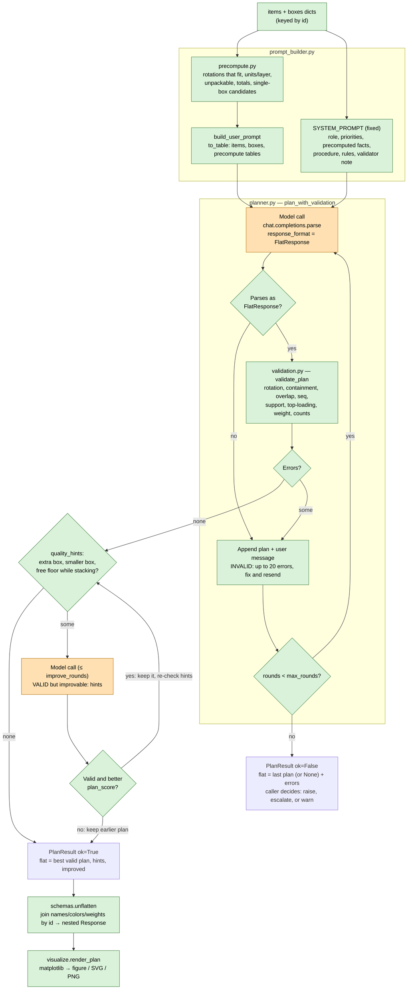

# packing

The packing pipeline: schemas, prompt input format, precompute, validation,
the plan → validate → fix loop, prompt builder, settings, code packer, and
the SVG renderer. **Single source of truth**: the playground backend
(`app/backend/app/`) and the labs notebook (`labs/manager.ipynb`) both import
it. Labs gets it as an editable path dependency of the root project
(`packing-playground-backend = { path = "app/backend", editable = true }` in
the root `pyproject.toml`); the backend's wheel ships only `packing`.

Rules for this package:
- No FastAPI, `agents`, or app imports; hooks (`on_event`, `should_stop`,
  `on_call`) let the app add progress, cancel and tracing.
- Does not pick a matplotlib backend (the server sets Agg in
  `app/__init__.py`; the notebook keeps its inline backend).
- Edit here, not in labs. Restart the notebook kernel after edits (modules
  are imported, not reloaded); the backend needs a restart too.

## Modules

- `schemas.py` — nested `Response` plan models, flat `FlatResponse` output
  models, and `unflatten`.
- `tabular.py` — token-reducing serializer for prompt input.
- `precompute.py` — fit checklist computed in code (rotations per box, units
  per layer, unpackable items, totals, single-box candidates) as prompt tables.
- `validation.py` — `validate_plan(flat, items, boxes) -> list[str]`, pure-code
  rule checks (empty list = valid); `quality_hints` for valid-but-wasteful
  plans; `plan_score` to compare plans.
- `prompt_builder.py` — `SYSTEM_PROMPT`, `GUIDE_SYSTEM_PROMPT` (fixed text) /
  `build_user_prompt(..., estimates, verbose_facts=False)` (compact facts:
  `compact_facts` = rotations + unpackable; `estimates_table`) /
  `starting_plan_text`. See "Prompt noise trim" below.
- `planner.py` — `plan_with_validation`: plan → validate → fix loop; hooks
  `on_event`, `should_stop` (raises `RunCancelled(result)`), `on_call`;
  `PlanResult.model_flat` / `model_errors` / `model_hints` keep the model's
  own plan when the packer wins; OpenAI errors mapped per the playground
  plan (auth/permission/not-found/bad-request re-raised, others = no plan).
- `packer.py` — `pack(items, boxes, settings, estimates=None)`: deterministic
  code packer (no LLM) → `(FlatResponse, errors)`; target and fallback for
  the planner; `estimates` collects one row per box type for the prompt.
  `pack_guided(...)` places units from the model's choices (guide mode).
- `repair.py` — `repair_help(flat, items, boxes, errors, settings)`: help
  lines for fix rounds (box size, tops under the unit, a free spot).
- `settings.py` — `PackingSettings` and everything that applies it;
  `extract_settings(...)` returns `(settings, usage, messages)` (usage
  `None` and messages `[]` when the text is empty and no call is made).
- `metrics.py` — evaluation: `plan_metrics(plan)` scores a nested
  `Response`; `compare(model, packer)` → one row per metric with the
  model's delta and verdict; `tally(rows)`. See "Metrics" below.
- `render_common.py` — shared renderer helpers (also used by the labs
  renderers): colors, unit cuboids in view coords, `paint_order`,
  `mirror_depth`, titles, footer lines.
- `render_svg.py` — `render_svg(plan, upto=None, box=None)`; `box` is the
  1-based physical box number (only that panel; legend and footer kept).

## Workflow

Green = plain code (free, exact). Orange = model call (costs tokens).

The loop returns as soon as a plan passes, so later rounds are only spent on
fixes. Each extra round resends the growing history and makes the model
write a full plan again (see "Offloading work from the model" below).

## Flat output (`schemas.py`)

The model returns only what it decides, as flat rows:
`boxes` (`box`, `id`), `placements` (`box`, `seq`, `id`, `pos` [x, y, z]
min corner, `dims` [x, y, z] rotated extents — one row per unit), `leftovers`
(`id`, `quantity`, `reason`), and `notes` (list of short instructions for
the person packing: how to load, the height to cut each box down to, how any
Additional instructions were applied; `[]` if none — required for strict
structured outputs). `unflatten` copies `notes` onto `Response.notes`; the
notebook's `report()` prints them. Notes are free text and not validated. `unflatten` joins name/color/weight/box
dimensions/`weightMax` back from the input records by `id`, injects the
fixed coordinate system, groups leftovers by reason, and raises `ValueError`
on unknown ids or placements in undeclared boxes. Roughly halves output
tokens and the response schema size versus the nested `Response`.

## Prompt input format (`tabular.py`)

`to_table(name, records, columns=None, rename=None, delimiter="|")` flattens
nested dicts to dotted keys (`dimensions.x`) and emits one header row plus one
row per record, instead of repeating keys per record. In the notebook,
`dimensions.*` are renamed to `x|y|z`; roughly halves the input size versus
Python repr. Each record must be a mapping — a stray trailing comma
(`item = {...},`) makes a tuple and raises `TypeError`.

## Offloading work from the model

Goal: let cheaper models (e.g. `gpt-5.4-mini` at `reasoning_effort="low"`)
match stronger ones by moving arithmetic and checking into code.

- **Precompute** (`precompute.py`): for each item × box pair, the rotations
  that fit, as `dx×dy×dz=P/layer×L → N layers, h H, floor F%` (P units per
  floor layer, L layers fit; this item type's quantity needs N layers reaching
  height H; one full layer covers F% of the floor), sorted lowest H first,
  separated by `;`, and `max_by_weight`; `ideal_fill_height` per candidate box
  (packable volume / floor area — the target fill height); item types that fit no box (`unpackable`); per-item and
  per-box volume/weight (printed by `id` only — names and box weightMax are
  already in the input tables); packable totals; `single_box_candidates` (box types
  whose volume and weight limit could hold everything — necessary, not
  sufficient). Candidates are **flagged** when an item type outnumbers its best
  single-rotation grid in that box (e.g. Wide Low: "Tape: grid fits 16 of 20")
  and sorted unflagged first, then by volume. Flagged, not dropped: mixed
  rotations can beat the grid count. `pre.unflagged_candidates` lists the rest.
- **Validation** (`validation.py`): no model involved. Checks declared boxes,
  known ids, dims are an allowed rotation, containment, pairwise overlaps,
  seq is 1..n per box, full Y–Z support for elevated units (and that supports
  load first), top-loading (no earlier unit above), weightMax, and placed + leftover = requested. Errors name units as
  `box N seq M (ref R)`. `fill_heights(flat)` gives max occupied X per box.
- **Repair loop** (`planner.py`): each round the model returns a full plan as
  structured output (`response_format=FlatResponse`); `validate_plan` checks
  it and errors go back as a user message (max 20 shown) asking for a full
  corrected plan. Stops at the first passing plan or after `max_rounds`
  (default 3) with `ok=False` and the last plan + errors — the caller must
  check `result.ok`. `PlanResult` has `flat`, `errors`, `ok`, `rounds`, token
  counts, and `history`. Not a function tool: `/v1/chat/completions` rejects
  function tools with `reasoning_effort` for `gpt-5.4-mini` ("use /v1/responses
  or set reasoning_effort to 'none'"). Structured output costs the same per
  round and works on any OpenAI-compatible backend.
- **Quality hints + improve round** (`validation.quality_hints`,
  `planner.py`): a valid plan can still be wasteful (seen: `gpt-5.4-mini` at
  `low` stacked tapes on the dispenser, left half of Medium's floor empty, and
  spilled 8 tapes into a second box). Hints flag: more than one box while an
  unflagged single-box candidate exists; a smaller unflagged candidate than
  the box used; units stacked above the floor while a free floor spot fits
  one. With hints, the model gets up to `improve_rounds` (default 1) extra
  calls; a reply replaces the plan only if valid and better by
  `plan_score` = (box count, total box volume, summed fill height), else the
  earlier plan is kept. `improve_rounds=0` disables it; `PlanResult.hints`
  still reports them.
- **Prompt builder** (`prompt_builder.py`): step-by-step procedure (unpackable
  → leftovers, smallest single-box candidate first, large/heavy items first,
  grid fill Z → Y → next X layer, finish layers, seq in order).
  `SYSTEM_PROMPT` is one fixed, readable string. Precomputed facts are
  always included, and every plan is validated in code
  (`planner.plan_with_validation`; the notebook's model cells and
  `evaluate.py` all use it), so the prompt always says "your plan is checked
  in code". The switches for precompute on/off and self-check were removed. A dedup trim of the wording (2026-10-04) gave worse
  results and was reverted. No per-item flags or policies
  (removed 2026-10-04 to keep it simple). `PACKAGE_MANAGER_SYSTEM_PROMPT_V*`
  in `system_prompts.py` are kept for comparison.

Naming: everything uses `id` (input dicts, prompt tables, model output, nested
`Response`); stats tables only add what the `items`/`boxes` tables don't
already have (no name, qty or weightMax). Only the archived
`_archive/evaluation/evaluate.py` reads `refId`, from the external engine's
files.

## Unpackable items

`precompute` marks an item type unpackable when it fits no box by size
("no allowed rotation of … fits any box") **or** fits by size but one unit
is heavier than every box it fits can carry ("one unit weighs … lb, more than
any box it fits can carry"); a box with `max_by_weight == 0` isn't a fit.
With nothing packable there are no single-box candidates. Notebook "Sample
order C" exercises this: 0 boxes, everything in leftovers; packer, planner,
`final_plan` and renderers handle an empty plan.

## Code packer (`packer.py`)

Added 2026-10-04 after a valid model plan stacked to 12.75 in where 9.5 was
possible (tapes in one back row + dispenser on top, instead of tapes turned
thin side to the front with the dispenser standing in the side strip).

`pack(items, boxes, settings)` — greedy extreme-point packing: each unit goes
to the lowest, then back-most, then left-most corner where it fits, checking
every rule as it places (containment, overlap, full support, top-loading,
weight, `no_stack`, `max_load`, `floor_only`, `keep_apart`). Rotations per item
type: all combinations when ≤ `MAX_COMBOS` (64), else one type at a time;
two type orders (volume, longest side). Best = fewest unplaced, then lowest
fill height. Boxes: the type that holds everything in the least volume, else
the one packing the most; respects stock and `max_boxes`. Result is checked
with `validate_plan` (`keep_together` isn't steered, only checked). Sample
cases all pack valid in < 0.1 s.

**Flat + shipped volume (2026-10-04).** On the golf order the packer stood
everything on edge in CASE (fill 10.63 of 11: nothing to cut off). Now: an
extra "everything flat" rotation pass (smallest side up); in-box ranking is
(unplaced, fill height, units standing on edge, summed tops); box choice is
the least *shipped* volume (`cut_height` × floor area) rather than full box
volume, so a bigger box filled low wins — golf → X4, all flat, fill 7, 6.25 in
to cut off. `validation.plan_score` also uses shipped volume (fill height ×
floor); the "try a smaller box" quality hint was removed (it pushed toward
small boxes filled to the top). The system prompt's priority 3 is now "least
shipped volume", priority 4 says lay items flat unless standing is needed to
fit, and procedure step 2 prefers the candidate where items lie flat in the
fewest layers even if the box is bigger.

`plan_with_validation(..., baseline=plan)`: the packer's plan is appended to
the last user message as a "Starting plan" (see below), it is the target
in the hints ("a valid plan exists with … filled to 9.5 in; yours …") and is
returned instead (`result.source == "packer"`, with a note) when it beats the
model's plan or the model has no valid plan. Ranking is `_rank` = (leftover
units, boxes, shipped volume, summed fill height); leftovers now count. When the
packer's plan is used, soft instructions are not applied (stated in the
notes). The notebook's main cell and `run_case` call `pack` first.

## Settings (`settings.py`)

Principle: anything code can do stays in code; the LLM only maps free text
onto settings. `PackingSettings` is the single schema both read:
- `padding` — inches on **every side**; each item dimension grows by
  2 × padding (4.75 → 5.0 at 0.125). `apply_padding(items, padding)` returns
  padded copies used for the prompt, planning and validation.
- `cut_step` — `cut_notes` / `final_plan` compute each box's cut-down height
  in code: the **resulting box height** is the fill height rounded up to a
  multiple of `cut_step` (the amount removed needn't be; 13.25 → 7 removes
  6.25). If that reaches the box's own height, the note says "no cut needed"
  instead of a non-multiple height. Notes read "Cut box N down to H in high,
  removing R in (…)", first in `plan.notes`. The model is told not to state
  cut heights, and extraction no longer copies a sentence that a setting
  already captures into `soft_instructions`.
- `blocks` — `BlockRule(item_id, size)`: units must stay together as solid,
  indivisible blocks of at most `size`. `split_balanced` uses the fewest
  blocks with sizes differing by at most 1 (11 at 4 → 4, 4, 3; 18 at 7 →
  6, 6, 6). Each block size becomes its own item type (new id, name like
  "Tape block of 4 (1×1×4)", weight × size). No rule = block size 1.
  Shape inside a block, parsed from the instructions:
  `arrangement="stack"` (default: one line along the unit's thinnest axis,
  largest faces together, like a stack of plates) or `"compact"` (smallest
  outer surface, code's choice); `grid=[a, b, c]` (units along the item's
  x, y, z, e.g. [1, 2, 2] = 2 by 2) applies only to blocks with exactly
  a·b·c units — with balanced splits (4, 4, 3) the others use `arrangement`.
  If the shape fits no box, it falls back to compact with a warning. A block
  of 1 keeps the original item. Planned, validated and drawn as single units.
  `_strict_schema` strips `default` keys recursively (nested models too).
- **Item rules** (code sets flags on the prepared item dicts; `precompute`
  and `validate_plan` read them; blocks inherit them):
  `upright` (x stays vertical: only rotations about x), `fixed_orientation`
  (no rotation), `no_stack_on` (nothing may rest on it), `max_load_on_top`
  (`LoadLimit(item_id, max_weight)`; conservative — every unit above the
  footprint counts fully), `floor_only_over_weight` (units/blocks heavier
  than this must have x = 0), `padding_by_item` (`ItemPadding`, overrides
  `padding`). Flags: `fixed`, `upright`, `no_stack`, `max_load`,
  `floor_only`, plus `source_id` (original id, kept by blocks).
- **Box rules**: `stock` is a field on the box dicts (blank = unlimited,
  0 = unusable: excluded from fits/candidates; validator counts boxes per
  type). `wall_clearance` shrinks box y/z by 2× in `prepare_boxes`.
  `carrier_max_weight` (incl. tare; `prepare_boxes` also lowers each box's
  `weightMax` to it so precompute agrees), `carrier_max_length`,
  `carrier_max_girth` (length + 2 × other sides), measured on the cut-down
  box. `min_cut_height` and `cut_step` feed `validation.cut_height`.
  `min_fill` (volume share after cutting down) is a quality hint.
- **Order rules**: `max_boxes`, `keep_together` / `keep_apart` (groups of
  original item ids, matched via `source_id`) are validator errors;
  `balance_boxes` is a quality hint (spread > 25% of mean weight).
- `soft_instructions` — everything else, passed as "Additional instructions".

`prepare_items(items, boxes, settings)`: flags → padding → blocks →
floor_only. `prepare_boxes(boxes, settings)`: wall clearance, carrier weight.
`rules_text(items, boxes, settings)` writes the hard rules in plain words; the
user prompt starts with them as "Packing rules:" (then Additional
instructions, then data). Rule flags are hidden from the items table
(`HIDDEN_ITEM_KEYS`). Pass `settings=` to `plan_with_validation` so box/order
rules are validated; plan, validate and display with the prepared items and
boxes. Unknown item ids in settings raise.
`extract_settings(..., items)` lists items by id and name so the model can map
"tapes" to an id.

`extract_settings(client, model, text)` does the mapping with a strict schema
(defaults stripped — strict mode has none); vague values stay unset and the
sentence stays a soft instruction. Set `PackingSettings(...)` directly to skip
the LLM. Not yet counted in the notebook's token report. Adding a setting = a
field + the code that applies it.

Units are fixed: inches and pounds. The model never outputs units;
`unflatten` sets `length_unit="in"`, `weight_unit="lb"` on the nested plan.

## Giving up is an error

`validate_plan` only checks placed + leftover = requested, so a model plan
with every unit in leftovers ("search failed") passed and got just one
improve round (gpt-5.4-nano did this on Sample A, 2026-10-05).
`planner._coverage_errors` fails a plan that leaves more units of an item
over than the packer's baseline does, naming the box type the packer used,
so it goes to a fix round. Only with a baseline; leftovers the packer also
leaves (nothing fits, Sample C) stay valid.

## Starting plan (seeding the model with the packer's plan)

Added 2026-10-05. Planning from scratch failed on Sample A for every cheap
model: gpt-5.4-nano/low gave up or made 7–27 overlap/support errors per
round; gpt-5.4-mini/low had geometry errors for 3 rounds; gpt-5.4-mini/medium
spent all 16k completion tokens on reasoning in each of 3 rounds and returned
nothing ($0.23). The packer solves it in 0.07 s.

So with a baseline, `plan_with_validation` appends
`prompt_builder.starting_plan_text(baseline, boxes)` to a copy of the last
user message: a summary line (box types, fill heights, leftovers), the plan
as compact JSON in the output format (packer notes excluded), and "improve it
by the Priorities … or return it unchanged with your notes". The system
prompt's input paragraph says the input may end with a Starting plan. Fix
feedback adds "If you cannot fix them, return the Starting plan unchanged."
The caller's `messages` are not mutated; `result.history` holds the seeded
prompt. An unchanged return ties the packer on `_rank`, so the model's plan
(with its notes and any soft instructions) is kept. Not yet measured with
real models.

`seed=False` turns it off (plan from scratch); the baseline is still the
hint target, the coverage check and the fallback. Playground:
`planning.start` = `"improve"` (default, seed) or `"scratch"`.

## Metrics (`metrics.py`): model vs code packer

Added 2026-10-05 to judge the model against the packer and tune prompts.
`plan_metrics(plan)` works on the nested `Response` (no items/boxes needed),
values rounded to 2 places. `METRICS` maps each to (label, unit, direction):

| metric | better | meaning |
|---|---|---|
| leftover_units | lower | units not packed |
| boxes | lower | physical boxes |
| shipped_volume | lower | Σ fill height × floor (in³), same as `plan_score`; `cut_step` not applied |
| box_volume | lower | Σ uncut internal volume |
| fill_rate | higher | unit volume / shipped volume (%) |
| max_fill_height | lower | tallest box fill (in) |
| units_on_floor | higher | % of units at x = 0 |
| cog_offset | lower | worst box: CoG distance from floor center, % of half the floor diagonal |
| cog_height | lower | worst box: CoG height, % of fill height |
| weight_spread | lower | heaviest − lightest box (lb) |
| total_weight, units_packed | info | no verdict |

`compare` gives `verdict` better/worse/same (|gain| ≤ 0.01 = same; None for
info rows or a missing side). Used by the playground (`GET /runs/{id}` →
`comparison`, computed on read so old runs have it) and the notebook's
evaluation cell (`labs/CLAUDE.md`). A model plan that equals the packer's is
"same" on every row — what "improve" returns when it can't improve.

## Why from-scratch plans failed, and the fixes (2026-10-05)

Analysis of the saved Sample A runs (no model calls): every from-scratch run
picked XL-18 because procedure step 2 preferred the lowest
`ideal_fill_height` "even if it is a bigger box" (XL-18 4.74 in, L-14
6.96 in, neither reachable with mixed sizes); the `fits` facts describe one
item type alone in an empty box (floor % adds up far past 100%); the errors
were stack-height bookkeeping (mugs "on the towel stack" at the first
towel's top, a cookbook spanning gaps); and each fix round rewrote the whole
plan (3 → 17 → 12 errors). Fixes:

1. **box_estimates** — `pack(..., estimates=[])` records how one box of each
   type did on the whole order (fits_all, units, fill_height, cut-down
   shipped_volume; free, the first box choice computes it). The user prompt
   ends with this table (`estimates_table`; shipped_volume blank unless
   fits_all). Procedure step 2 now picks the fits_all box with the lowest
   shipped_volume; ideal_fill_height is called a lower bound; the fits
   bullet says each row is the item alone; steps 4–5 cover standing flat
   items on edge and tracking each stack's top height. The pipeline (and the
   notebook) run the packer before building the prompt. The prompt before
   this is `labs/system_prompts.py` `PACKAGE_MANAGER_SYSTEM_PROMPT_V6`.
2. **Patch-style fix rounds** — `repair.units_to_move` takes the unit named
   in each error (the later seq of an overlap); `repair_help` keeps every
   other unit fixed and gives the box's inside size, the unit's extents and
   the tops under its footprint, and a free spot found with the packer's
   `_fits_here` (current rotation first, then others; "rests on seq N, so
   its seq must be after those"). Feedback asks to change only those units
   and copy the rest. If a reply has more errors than the best plan so far,
   the next message is "Go back to that plan" with its JSON, errors and help
   (`_back_to_best`); when rounds run out, the model side reports that best
   plan, not the last.
3. **Guide mode** — `plan_with_guidance` + `GUIDE_SYSTEM_PROMPT`: the model
   returns `schemas.Guidance` (box type per physical box, item order, one
   rotation per item type, notes); `packer.pack_guided` opens those boxes in
   order and places every unit at the lowest, back-most, left-most valid
   spot. Bad choices (unknown ids, a rotation not allowed) and failed
   validation/coverage go back as feedback with the placement summary; a
   valid placement worse than the packer gets another round to beat it;
   best valid kept, baseline fallback as usual. One rotation per item type
   across all boxes, so multi-box orders where the packer rotates an item
   differently per box can't be reproduced exactly (seen offline on
   carrier_limits and balance). `planner.guidance_from_plan` gives a plan's
   implied choices (FakeClient uses it).
4. "improve" (Starting plan) stays the playground default.

### Follow-up after real runs (2026-10-05)

Runs after the fixes: Sample A scratch chose L-14 (box_estimates worked) but
placed only the plates and then said it "cannot reliably derive the exact
support-aligned coordinates"; Sample B scratch went 13 → 10 → 1 error (5
desk lamps left over). Two fixes:
- Progress is `repair.gap` (units to move + units not placed that the packer
  placed + errors naming no unit), not the error count: an empty plan had
  only 1 error and became the "best" plan.
- `repair_help(..., baseline)` also gives spots, in the plan's own boxes,
  for every unit it should place but left out (`units_short`), each spot
  counted as taken for the next.

Validator check: an independent checker (area-sum support, sorted-sides
rotations, overlap volume) agreed with `validate_plan` on 7,525 plans
(packer plans for every order/case plus random mutations) and on every
saved model plan. Gap found and fixed: a declared box with no units passed;
it is now an error ("box N is declared but holds no units").

`box_estimates` `fits_all` means every *packable* unit placed: items that
fit no box (precompute's `unpackable`) don't count against it. Before this,
an order with one unpackable item (Sample D's 28 in stands) showed
fits_all = false and no shipped volume for every box.

## Prompt noise trim (2026-10-05)

Sample A sent ~4,660 tokens before any planning: system 1,626 + user 3,037,
of which the `fits` table (every item × every box × every rotation with
per-item-alone layer counts and floor %) was 2,525. Now:

- User prompt (compact facts, default): items (no color column), boxes,
  `rotations` (per item, the rotations that fit at least one usable box by
  size and weight, in `item_rotations` order), `unpackable` (with reasons),
  `box_estimates`. Dropped: fits, item_stats, box_stats, totals,
  single_box_candidates, ideal_fill_height (the misleading lower bound).
  Sample A 3,037 → 524 tokens; B 3,401 → 576; C 404 → 263; D 944 → 357.
- `SYSTEM_PROMPT` 1,626 → 746 tokens: one-line priorities; one input list
  (incl. the Starting plan); each rule stated once (support was in three
  places); a 3-step "How to plan" instead of the 7-step grid procedure;
  output notes only for what the JSON schema doesn't say (leftover reasons,
  notes). `GUIDE_SYSTEM_PROMPT` lists the same compact facts.
- The previous prompt is `labs/system_prompts.py`
  `PACKAGE_MANAGER_SYSTEM_PROMPT_V7`; it goes with
  `build_user_prompt(..., verbose_facts=True)` (old tables and colors). The
  notebook's evaluation cell has a commented "nano low scratch V7" setup for
  the A/B. Not yet measured with real models.

`precompute_tables`, `single_box_candidates`, `ideal_fill_height` etc. still
exist in `precompute.py` for the verbose facts.
