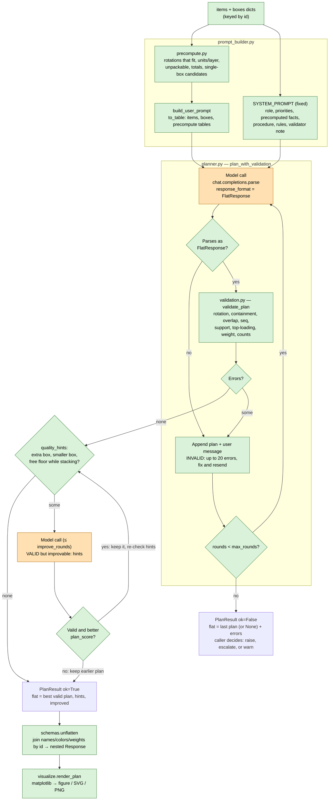

# labs

Experimentation notebook for an LLM-driven 3D box packing planner.

## Workflow

Green = plain code (free, exact). Orange = model call (costs tokens).



The loop returns as soon as a plan passes, so later rounds are only spent on
fixes. Each extra round resends the growing history and makes the model
write a full plan again (see "Offloading work from the model" below).

## Key files

- `manager.ipynb` — builds the prompt from `items` / `boxes` dicts (both keyed
  by `id`), calls the model (OpenAI or local Ollama at
  `http://localhost:11434/v1`) with `response_format=FlatResponse`, then
  `unflatten(flat, items, boxes)` to get the nested `Response`.
- `schemas.py` — nested `Response` plan models, flat `FlatResponse` output
  models, and `unflatten`.
- `system_prompts.py` — system prompt versions (`PACKAGE_MANAGER_SYSTEM_PROMPT_V*`).
  V4 pairs with `FlatResponse`; V1–V3 describe the nested `Response`.
- `tabular.py` — token-reducing serializer for prompt input.
- `visualize.py` — matplotlib renderer for a nested `Response` plan.
- `render_common.py` — shared renderer helpers: colors, unit cuboids in view
  coords, `paint_order`, `mirror_depth`, titles, leftover lines.
- `render_plotly.py`, `render_svg.py`, `render_pyvista.py`, `render_vedo.py`,
  `render_threejs.py` — alternative renderers (see "Other renderers").
- `precompute.py` — fit checklist computed in code (rotations per box, units
  per layer, unpackable items, totals, single-box candidates) as prompt tables.
- `validation.py` — `validate_plan(flat, items, boxes) -> list[str]`, pure-code
  rule checks (empty list = valid); `quality_hints` for valid-but-wasteful
  plans; `plan_score` to compare plans.
- `prompt_builder.py` — `SYSTEM_PROMPT` (fixed text) / `build_user_prompt`.
- `planner.py` — `plan_with_validation`: plan → validate → fix loop.
- `packer.py` — `pack(items, boxes, settings)`: deterministic code packer (no LLM) → `(FlatResponse, errors)`; target and fallback for the planner.
- `settings.py` — `PackingSettings` (padding, cut_step, blocks, soft_instructions): free text → settings via one LLM call; padding, blocks and cut heights applied in code.

## Flat output (`schemas.py`)

The model returns only what it decides, as flat rows:
`boxes` (`box`, `id`), `placements` (`box`, `seq`, `id`, `pos` [x, y, z]
min corner, `dims` [x, y, z] rotated extents — one row per unit), `leftovers`
(`id`, `quantity`, `reason`), and `notes` (list of short instructions for
the person packing: how to load, the height to cut each box down to, how any
Additional instructions were applied; `[]` if none — required for strict
structured outputs). `unflatten` copies `notes` onto `Response.notes`; the
notebook's `report()` prints them. Notes are free text and not validated. `unflatten` joins name/color/weight/box
dimensions/`weightMax` back from the input records by `id`, injects the
fixed coordinate system, groups leftovers by reason, and raises `ValueError`
on unknown ids or placements in undeclared boxes. Roughly halves output
tokens and the response schema size versus the nested `Response`.

## Prompt input format (`tabular.py`)

`to_table(name, records, columns=None, rename=None, delimiter="|")` flattens
nested dicts to dotted keys (`dimensions.x`) and emits one header row plus one
row per record, instead of repeating keys per record. In the notebook,
`dimensions.*` are renamed to `x|y|z`; roughly halves the input size versus
Python repr. Each record must be a mapping — a stray trailing comma
(`item = {...},`) makes a tuple and raises `TypeError`.

## Token usage and cost

`PlanResult` sums `prompt_tokens` (input), `completion_tokens` (output, which
includes reasoning) and `reasoning_tokens` over every call in the loop;
`total_tokens` = input + output. The notebook's `report(result, model)` prints
them plus a cost estimate from its `PRICES` table (USD per 1M tokens, input /
output; looked up 2026-10-04: gpt-5.4-nano 0.20 / 1.25, gpt-5.4-mini 0.75 /
4.50; free/local models 0). Unknown models print "add to PRICES".

## Env vars

- `OPENAI_API_KEY` (from `.env`) — only when using the OpenAI client.
- `OPENROUTER_API_KEY` (from `.env`) — for open-source models via OpenRouter
  (`base_url="https://openrouter.ai/api/v1"`, same OpenAI client). Pass
  effort as `extra_body={"reasoning": {"effort": "low"}, "provider":
  {"require_parameters": True}}`; `require_parameters` routes only to
  providers that support structured outputs. See the OpenRouter notebook cell.

## Visualizer (`visualize.py`)

`render_plan(plan, upto=None, path=None)` draws one 3D panel per box:
black wireframe for the internal box, each packed unit as a shaded block in
the item's input color (tab10 fallback if not a valid matplotlib color), the
`packed_index` on each unit, a legend, and a footer listing leftovers.

Blocks are not `bar3d`: mplot3d has no depth buffer and sorts each collection
by average depth, so a tall unit next to a stack of thin ones was drawn over
them (the dispenser showed through the tape stacks). Instead `_paint_order`
orders units back to front by which side of their separating plane faces the
camera (topological sort, depth fallback), each unit draws only its three
camera-facing faces, `ax.computed_zorder = False` keeps that order, and box
edges are split into back (under units) and front (over units). The order is
computed for the default view, so interactive rotation can show artifacts.
Plan X is height, so everything is drawn at (z, y, x) to put height on
matplotlib's vertical axis. `upto=N` shows only the first N loading steps;
`path` saves the figure (extension picks svg/png/pdf). Step labels are
projected to 2D so bars can't hide them, which means they don't follow
interactive rotation.

### Footer: leftovers and packing notes

Every renderer shows a footer from `render_common.footer_lines(plan, width)`:
"Not packed — …" for leftovers, then "Packing notes:" with the plan's `notes`
numbered. matplotlib, Plotly, SVG and three.js draw it as text below the
boxes; PyVista and vedo images get a white band added under the render by
`render_common.add_footer` (DejaVu Sans from matplotlib, since PIL's default
font lacks "—" and "×").

### Other renderers

All take a nested `Response` plus optional `upto`, and draw in view coords
(u, v, w) = (Z span, Y depth, X height) from `render_common`. Shared view:
front-right-top, so the box origin (back-left-bottom) is the far corner and
Z runs left to right.

| Module | Function → returns | Notes |
|---|---|---|
| `render_plotly.py` | `render_plotly(plan)` → `go.Figure` | Interactive in notebook, hover info, real depth buffer. `fig.to_image(format="png"/"svg")` needs kaleido + Chrome; `fig.to_html(include_plotlyjs="cdn")` for a page. Y range reversed + camera at scene −y so Z isn't mirrored. Units inset 0.03 so edge lines aren't hidden. |
| `render_svg.py` | `render_svg(plan)` → SVG `str` | No extra deps, ~13 KB for the test plan (matplotlib SVG ~88 KB), real text labels; best fit for the image API. Orthographic, back-to-front via `paint_order`, three faces per unit. |
| `render_pyvista.py` | `render_pyvista(plan, off_screen=True)` → `PIL.Image` | Lit VTK render. Uses `mirror_depth` (VTK is right-handed; the plan frame is left-handed). Legend is positioned text: `add_legend` overflowed the window. |
| `render_vedo.py` | `render_vedo(plan, off_screen=True)` → `PIL.Image` | Same as PyVista via vedo; its default font drops "—" and "×". |
| `render_threejs.py` | `render_threejs(plan)` → HTML `str`; `threejs_iframe(page)` for notebooks | Orbit controls, step slider (`upto` = starting step), CSS2D labels. three.js 0.170.0 from jsDelivr CDN, so viewing needs internet. Maps (u, w, v) → three (x, y, z), right-handed, no mirroring. |

Painter-style renderers (matplotlib, SVG) need `paint_order`; Plotly, VTK,
and three.js use a depth buffer. Dependencies: `plotly`, `kaleido`,
`pyvista`, `vedo` (pulls in `vtk`).

### Rendering without writing a file

Omit `path` and nothing touches disk; in a notebook the figure shows inline.
For bytes or text in memory, `savefig` into a `BytesIO`:

```python
from io import BytesIO
import matplotlib.pyplot as plt

fig = render_plan(plan)
buf = BytesIO()
fig.savefig(buf, format="svg", bbox_inches="tight")  # or format="png"
plt.close(fig)

svg_text = buf.getvalue().decode()  # SVG string; PNG: use buf.getvalue()
```

Show an in-memory SVG in the notebook: `IPython.display.SVG(svg_text)`.

## Planned: image API (not built yet)

Decisions so far for an endpoint that returns the plan image:

- Default to **SVG**, with `?format=svg|png`. SVG stays sharp and keeps step
  numbers as text; PNG suits email, PDF, mobile, thumbnails, and very large
  plans (SVG grows per item; PNG size depends on pixel size). For the 21-unit
  test plan: SVG 88 KB, PNG 74 KB.
- Return **raw bytes as the response body** with `image/svg+xml` or
  `image/png`, not base64 in JSON (~33% larger, client must decode). If the
  plan JSON is also needed, return it with an `image_url` instead.
- Server rendering: `matplotlib.use("Agg")`, render into `BytesIO` as above,
  and always `plt.close(fig)` — pyplot keeps figures in memory until closed.
  pyplot isn't thread-safe; under concurrency use a process pool or build
  figures with `matplotlib.figure.Figure` instead of pyplot.
- Plans render deterministically, so cache the image per plan.
- Alternative for a web UI: return only the plan JSON and draw it client-side
  (e.g. three.js) for rotate/zoom; keep server rendering for exports.

## Offloading work from the model

Goal: let cheaper models (e.g. `gpt-5.4-mini` at `reasoning_effort="low"`)
match stronger ones by moving arithmetic and checking into code.

- **Precompute** (`precompute.py`): for each item × box pair, the rotations
  that fit, as `dx×dy×dz=P/layer×L → N layers, h H, floor F%` (P units per
  floor layer, L layers fit; this item type's quantity needs N layers reaching
  height H; one full layer covers F% of the floor), sorted lowest H first,
  separated by `;`, and `max_by_weight`; `ideal_fill_height` per candidate box
  (packable volume / floor area — the target fill height); item types that fit no box (`unpackable`); per-item and
  per-box volume/weight (printed by `id` only — names and box weightMax are
  already in the input tables); packable totals; `single_box_candidates` (box types
  whose volume and weight limit could hold everything — necessary, not
  sufficient). Candidates are **flagged** when an item type outnumbers its best
  single-rotation grid in that box (e.g. Wide Low: "Tape: grid fits 16 of 20")
  and sorted unflagged first, then by volume. Flagged, not dropped: mixed
  rotations can beat the grid count. `pre.unflagged_candidates` lists the rest.
- **Validation** (`validation.py`): no model involved. Checks declared boxes,
  known ids, dims are an allowed rotation, containment, pairwise overlaps,
  seq is 1..n per box, full Y–Z support for elevated units (and that supports
  load first), top-loading (no earlier unit above), weightMax, and placed + leftover = requested. Errors name units as
  `box N seq M (ref R)`. `fill_heights(flat)` gives max occupied X per box.
- **Repair loop** (`planner.py`): each round the model returns a full plan as
  structured output (`response_format=FlatResponse`); `validate_plan` checks
  it and errors go back as a user message (max 20 shown) asking for a full
  corrected plan. Stops at the first passing plan or after `max_rounds`
  (default 3) with `ok=False` and the last plan + errors — the caller must
  check `result.ok`. `PlanResult` has `flat`, `errors`, `ok`, `rounds`, token
  counts, and `history`. Not a function tool: `/v1/chat/completions` rejects
  function tools with `reasoning_effort` for `gpt-5.4-mini` ("use /v1/responses
  or set reasoning_effort to 'none'"). Structured output costs the same per
  round and works on any OpenAI-compatible backend.
- **Quality hints + improve round** (`validation.quality_hints`,
  `planner.py`): a valid plan can still be wasteful (seen: `gpt-5.4-mini` at
  `low` stacked tapes on the dispenser, left half of Medium's floor empty, and
  spilled 8 tapes into a second box). Hints flag: more than one box while an
  unflagged single-box candidate exists; a smaller unflagged candidate than
  the box used; units stacked above the floor while a free floor spot fits
  one. With hints, the model gets up to `improve_rounds` (default 1) extra
  calls; a reply replaces the plan only if valid and better by
  `plan_score` = (box count, total box volume, summed fill height), else the
  earlier plan is kept. `improve_rounds=0` disables it; `PlanResult.hints`
  still reports them.
- **Prompt builder** (`prompt_builder.py`): step-by-step procedure (unpackable
  → leftovers, smallest single-box candidate first, large/heavy items first,
  grid fill Z → Y → next X layer, finish layers, seq in order).
  `SYSTEM_PROMPT` is one fixed, readable string. Precomputed facts are
  always included, and every plan is validated in code
  (`planner.plan_with_validation`; the notebook's model cells and
  `evaluate.py` all use it), so the prompt always says "your plan is checked
  in code". The switches for precompute on/off and self-check were removed. A dedup trim of the wording (2026-10-04) gave worse
  results and was reverted. No per-item flags or policies
  (removed 2026-10-04 to keep it simple). `PACKAGE_MANAGER_SYSTEM_PROMPT_V*`
  in `system_prompts.py` are kept for comparison.

Naming: everything uses `id` (input dicts, prompt tables, model output, nested
`Response`); stats tables only add what the `items`/`boxes` tables don't
already have (no name, qty or weightMax). Only the archived
`_archive/evaluation/evaluate.py` reads `refId`, from the external engine's
files.

## Unpackable items

`precompute` marks an item type unpackable when it fits no box by size
("no allowed rotation of … fits any box") **or** fits by size but one unit
is heavier than every box it fits can carry ("one unit weighs … lb, more than
any box it fits can carry"); a box with `max_by_weight == 0` isn't a fit.
With nothing packable there are no single-box candidates. Notebook "Sample
order C" exercises this: 0 boxes, everything in leftovers; packer, planner,
`final_plan` and renderers handle an empty plan.

## Code packer (`packer.py`)

Added 2026-10-04 after a valid model plan stacked to 12.75 in where 9.5 was
possible (tapes in one back row + dispenser on top, instead of tapes turned
thin side to the front with the dispenser standing in the side strip).

`pack(items, boxes, settings)` — greedy extreme-point packing: each unit goes
to the lowest, then back-most, then left-most corner where it fits, checking
every rule as it places (containment, overlap, full support, top-loading,
weight, `no_stack`, `max_load`, `floor_only`, `keep_apart`). Rotations per item
type: all combinations when ≤ `MAX_COMBOS` (64), else one type at a time;
two type orders (volume, longest side). Best = fewest unplaced, then lowest
fill height. Boxes: the type that holds everything in the least volume, else
the one packing the most; respects stock and `max_boxes`. Result is checked
with `validate_plan` (`keep_together` isn't steered, only checked). Sample
cases all pack valid in < 0.1 s.

**Flat + shipped volume (2026-10-04).** On the golf order the packer stood
everything on edge in CASE (fill 10.63 of 11: nothing to cut off). Now: an
extra "everything flat" rotation pass (smallest side up); in-box ranking is
(unplaced, fill height, units standing on edge, summed tops); box choice is
the least *shipped* volume (`cut_height` × floor area) rather than full box
volume, so a bigger box filled low wins — golf → X4, all flat, fill 7, 6.25 in
to cut off. `validation.plan_score` also uses shipped volume (fill height ×
floor); the "try a smaller box" quality hint was removed (it pushed toward
small boxes filled to the top). The system prompt's priority 3 is now "least
shipped volume", priority 4 says lay items flat unless standing is needed to
fit, and procedure step 2 prefers the candidate where items lie flat in the
fewest layers even if the box is bigger.

`plan_with_validation(..., baseline=plan)`: the packer's plan is the target
in the hints ("a valid plan exists with … filled to 9.5 in; yours …") and is
returned instead (`result.source == "packer"`, with a note) when it beats the
model's plan or the model has no valid plan. Ranking is `_rank` = (leftover
units, boxes, shipped volume, summed fill height); leftovers now count. When the
packer's plan is used, soft instructions are not applied (stated in the
notes). The notebook's main cell and `run_case` call `pack` first.

## Sample cases (evaluation)

The notebook's last cells replace the old Paccurate evaluation (archived in
`_archive/evaluation/`): `CASES` holds one small order per rule (basic,
padding_cut, blocks, upright, fixed, no_stack, max_load, floor_only,
padding_by_item [free text], stock, wall_clearance, carrier_limits, min_cut,
min_fill, max_boxes, keep_together, keep_apart, balance, soft_instructions
[free text]) over shared `BOXES` (Small/Medium/Large). `run_case(case, model)`
runs settings → prepare → prompt → `plan_with_validation` → `final_plan`;
the run-all cell prints a table (ok, rounds, boxes, leftover, tokens, cost,
first error); the last cell draws one case as SVG. Each case costs one
planner run (plus one extraction call for text cases).

System prompt priorities (after pack-all, fewest boxes, least box volume):
maximize floor use across the Y–Z footprint so free space stays on top for
cutting the box down, then a centered center of gravity (spread left-right
and front-back, low in X); procedure step 6 spreads a partial top layer
instead of crowding a corner.

Extra instructions: `build_user_prompt(items, boxes, instructions)` appends
free text (policies, rules, preferences) **before** the data as "Additional
instructions:" (moved to the front 2026-10-04: at the end it wasn't being
followed); empty/whitespace adds nothing. The system prompt says to follow
them unless they conflict with the Rules, which always win. They are not
checked by `validate_plan`. Notebook: set `INSTRUCTIONS` in the prompts cell.

Floating units (2026-10-04): a run returned `ok=False` with 12 "not fully
supported" errors after the model centered the dispenser and stacked tapes
half on it; the notebook drew the rejected plan anyway. Fixes: the Rules now
say "No floating units" explicitly, procedure step 5 says to check support
before placing above the floor, priority 5 limits centering to the top layer,
and the notebook's model cell raises instead of drawing when `result.ok` is
False.

## Settings (`settings.py`)

Principle: anything code can do stays in code; the LLM only maps free text
onto settings. `PackingSettings` is the single schema both read:
- `padding` — inches on **every side**; each item dimension grows by
  2 × padding (4.75 → 5.0 at 0.125). `apply_padding(items, padding)` returns
  padded copies used for the prompt, planning and validation.
- `cut_step` — `cut_notes` / `final_plan` compute each box's cut-down height
  in code: the **resulting box height** is the fill height rounded up to a
  multiple of `cut_step` (the amount removed needn't be; 13.25 → 7 removes
  6.25). If that reaches the box's own height, the note says "no cut needed"
  instead of a non-multiple height. Notes read "Cut box N down to H in high,
  removing R in (…)", first in `plan.notes`. The model is told not to state
  cut heights, and extraction no longer copies a sentence that a setting
  already captures into `soft_instructions`.
- `blocks` — `BlockRule(item_id, size)`: units must stay together as solid,
  indivisible blocks of at most `size`. `split_balanced` uses the fewest
  blocks with sizes differing by at most 1 (11 at 4 → 4, 4, 3; 18 at 7 →
  6, 6, 6). Each block size becomes its own item type (new id, name like
  "Tape block of 4 (1×1×4)", weight × size). No rule = block size 1.
  Shape inside a block, parsed from the instructions:
  `arrangement="stack"` (default: one line along the unit's thinnest axis,
  largest faces together, like a stack of plates) or `"compact"` (smallest
  outer surface, code's choice); `grid=[a, b, c]` (units along the item's
  x, y, z, e.g. [1, 2, 2] = 2 by 2) applies only to blocks with exactly
  a·b·c units — with balanced splits (4, 4, 3) the others use `arrangement`.
  If the shape fits no box, it falls back to compact with a warning. A block
  of 1 keeps the original item. Planned, validated and drawn as single units.
  `_strict_schema` strips `default` keys recursively (nested models too).
- **Item rules** (code sets flags on the prepared item dicts; `precompute`
  and `validate_plan` read them; blocks inherit them):
  `upright` (x stays vertical: only rotations about x), `fixed_orientation`
  (no rotation), `no_stack_on` (nothing may rest on it), `max_load_on_top`
  (`LoadLimit(item_id, max_weight)`; conservative — every unit above the
  footprint counts fully), `floor_only_over_weight` (units/blocks heavier
  than this must have x = 0), `padding_by_item` (`ItemPadding`, overrides
  `padding`). Flags: `fixed`, `upright`, `no_stack`, `max_load`,
  `floor_only`, plus `source_id` (original id, kept by blocks).
- **Box rules**: `stock` is a field on the box dicts (blank = unlimited,
  0 = unusable: excluded from fits/candidates; validator counts boxes per
  type). `wall_clearance` shrinks box y/z by 2× in `prepare_boxes`.
  `carrier_max_weight` (incl. tare; `prepare_boxes` also lowers each box's
  `weightMax` to it so precompute agrees), `carrier_max_length`,
  `carrier_max_girth` (length + 2 × other sides), measured on the cut-down
  box. `min_cut_height` and `cut_step` feed `validation.cut_height`.
  `min_fill` (volume share after cutting down) is a quality hint.
- **Order rules**: `max_boxes`, `keep_together` / `keep_apart` (groups of
  original item ids, matched via `source_id`) are validator errors;
  `balance_boxes` is a quality hint (spread > 25% of mean weight).
- `soft_instructions` — everything else, passed as "Additional instructions".

`prepare_items(items, boxes, settings)`: flags → padding → blocks →
floor_only. `prepare_boxes(boxes, settings)`: wall clearance, carrier weight.
`rules_text(items, boxes, settings)` writes the hard rules in plain words; the
user prompt starts with them as "Packing rules:" (then Additional
instructions, then data). Rule flags are hidden from the items table
(`HIDDEN_ITEM_KEYS`). Pass `settings=` to `plan_with_validation` so box/order
rules are validated; plan, validate and display with the prepared items and
boxes. Unknown item ids in settings raise.
`extract_settings(..., items)` lists items by id and name so the model can map
"tapes" to an id.

`extract_settings(client, model, text)` does the mapping with a strict schema
(defaults stripped — strict mode has none); vague values stay unset and the
sentence stays a soft instruction. Set `PackingSettings(...)` directly to skip
the LLM. Not yet counted in the notebook's token report. Adding a setting = a
field + the code that applies it.

Units are fixed: inches and pounds. The model never outputs units;
`unflatten` sets `length_unit="in"`, `weight_unit="lb"` on the nested plan.
